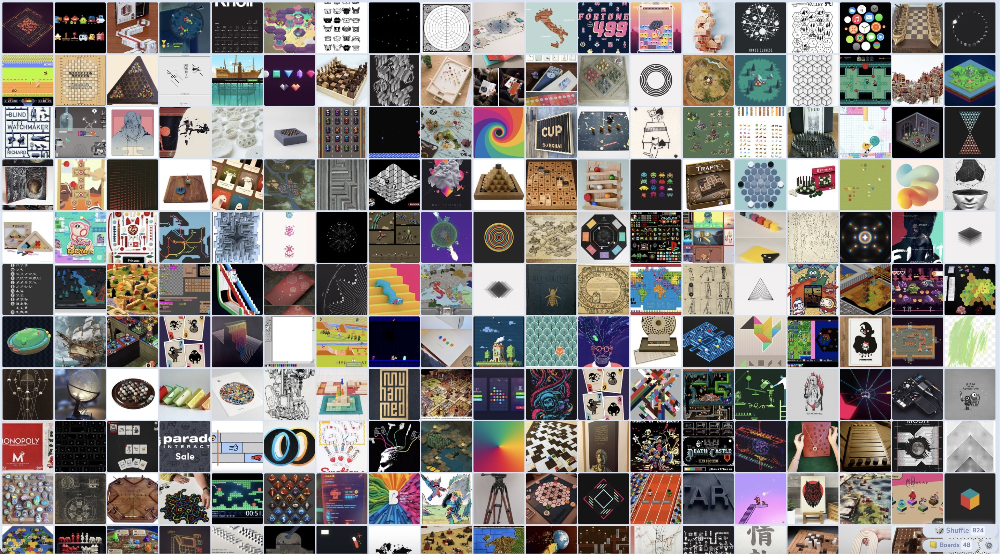
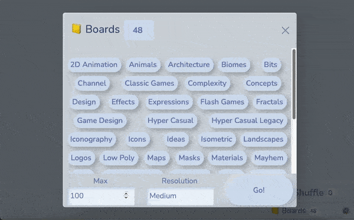

# [Pin Shuffle](https://pinshuffle.fly.dev) - Pinterest Board Randomizer

*Are you an avid **Pinterest** user?*

*Don't you wish there was a way to shuffle all those pins?*

**[Pin Shuffle](https://pinshuffle.fly.dev)** to the rescue!



## How to Use

1. Login with your Pinterest account
1. Select some boards you'd like to mix, or turn on *Show sections* to pick parts of them
2. Specify the total number of pins to load
3. Hit go and start **shuffling!**




## Running it

Create a `.env` file with the credentials of your Pinterest app:

| Variable | Description |
| --- | --- |
| `CLIENT_ID`, `CLIENT_SECRET` | Pinterest app credentials |
| `BASE_URL` | Optional. Where the app is hosted, defaults to production. `{BASE_URL}/redirect/` must be registered as a redirect URI |
| `PORT` | Optional. Defaults to `8275` |
| `MONITOR_PASSWORD` | Optional. Enables `/monitor`, log in as `admin` |

```sh
go run .        # real thing
go run . -mock  # fake data, no Pinterest account required
go test ./...
```

Feel free to contribute.

Emoji graphics are from [Twemoji](https://github.com/jdecked/twemoji), licensed under [CC-BY 4.0](https://creativecommons.org/licenses/by/4.0/).
